# 启明 PPT

> 把想法，讲成一场好戏。  
> 一个本地优先的 AI 演示创作软件：描述主题 → AI 大纲 → 选择模板 → 动画 / 旁白 / 动态视频 → 导出无水印 PPTX。

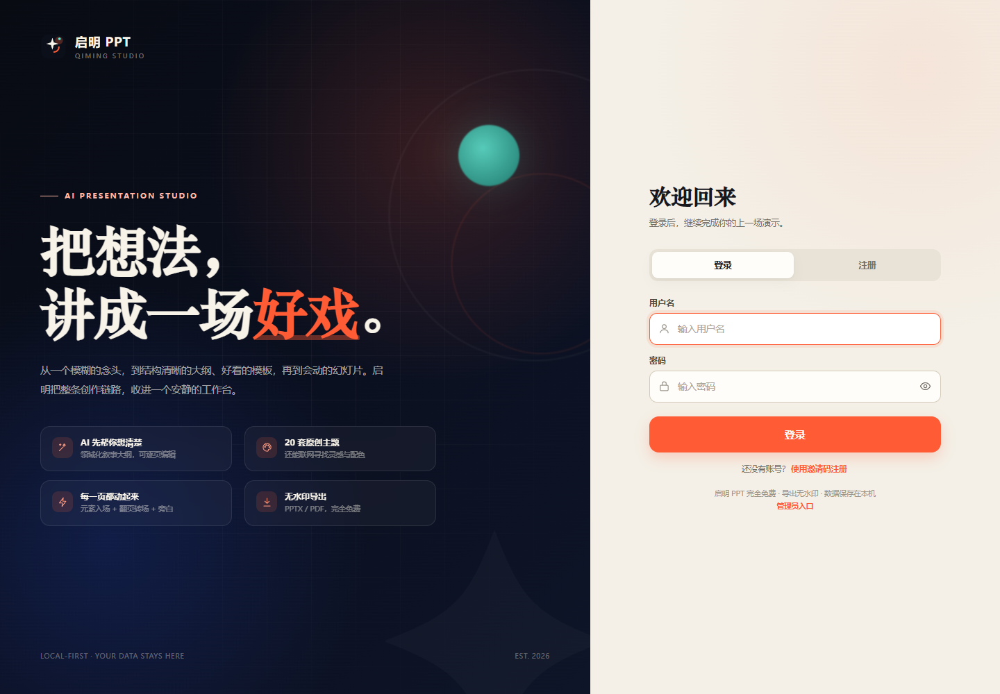

### 界面一览

| 工作台 | AI 大纲 |
| --- | --- |
|  | 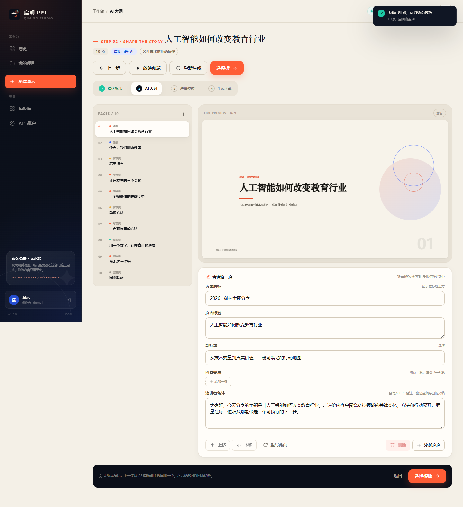 |

| 模板库 | 生成完成 |
| --- | --- |
| 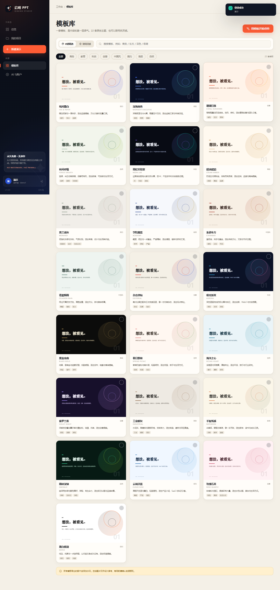 | 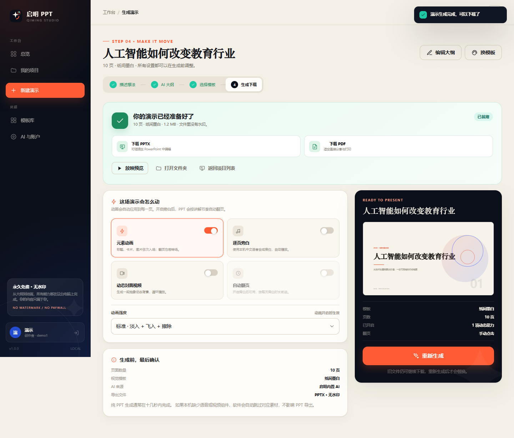 |

| 管理后台 | 在线模板 |
| --- | --- |
| 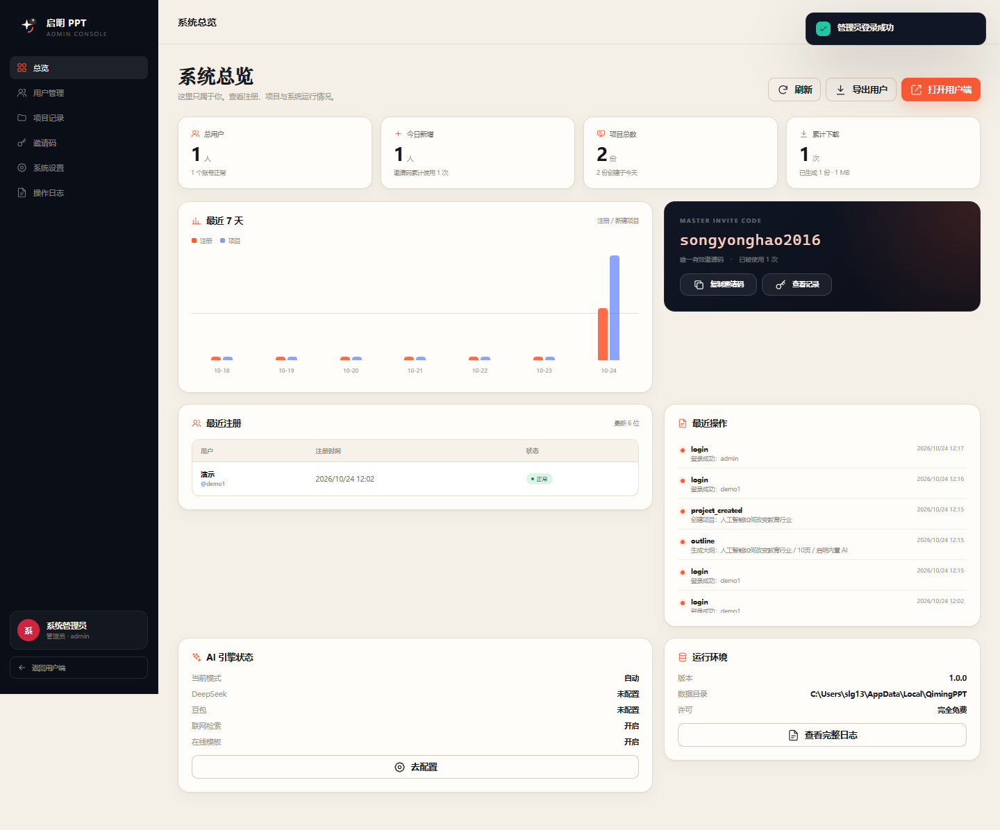 | 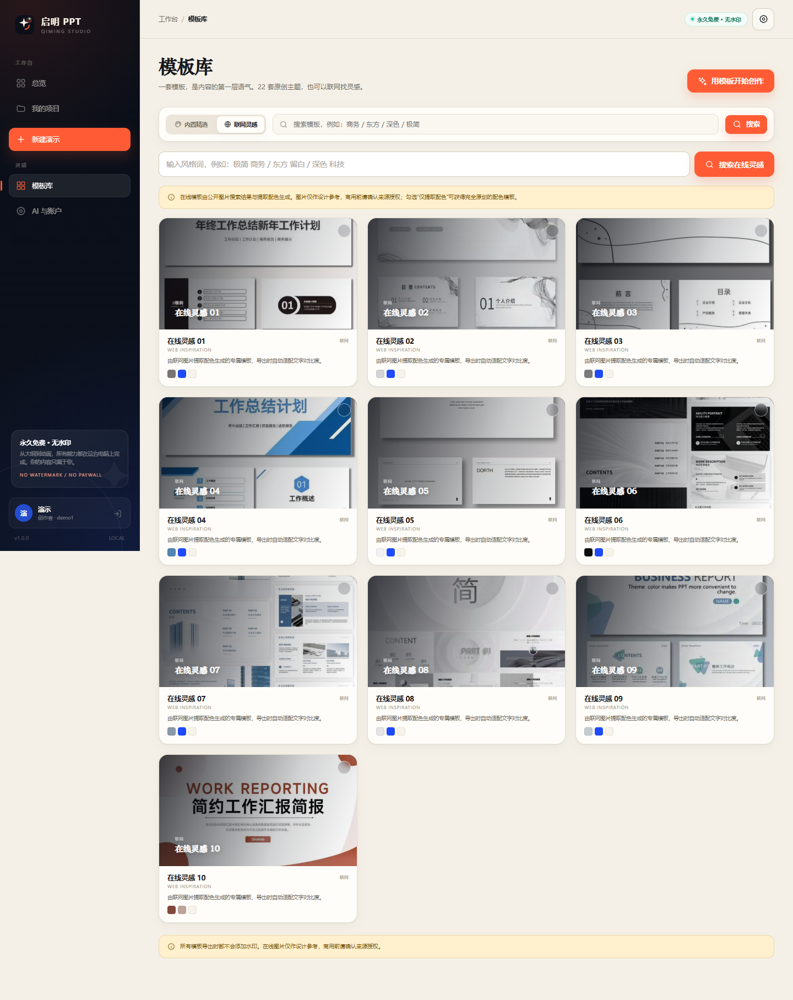 |

邮箱验证码注册页：

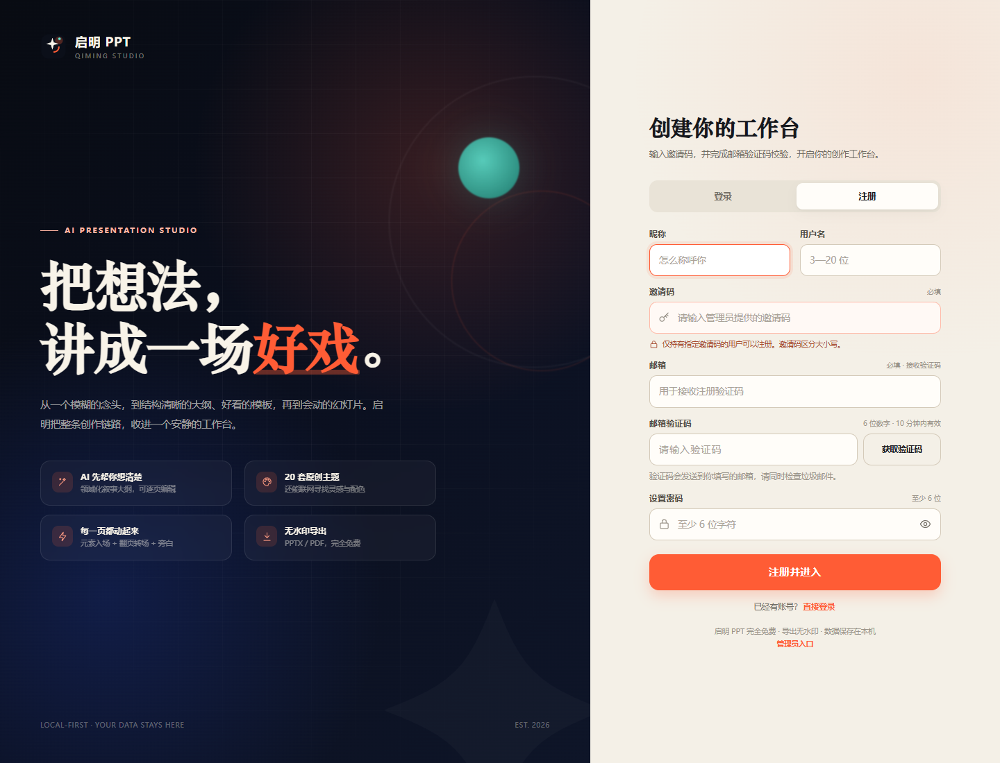

管理后台 SMTP 配置：

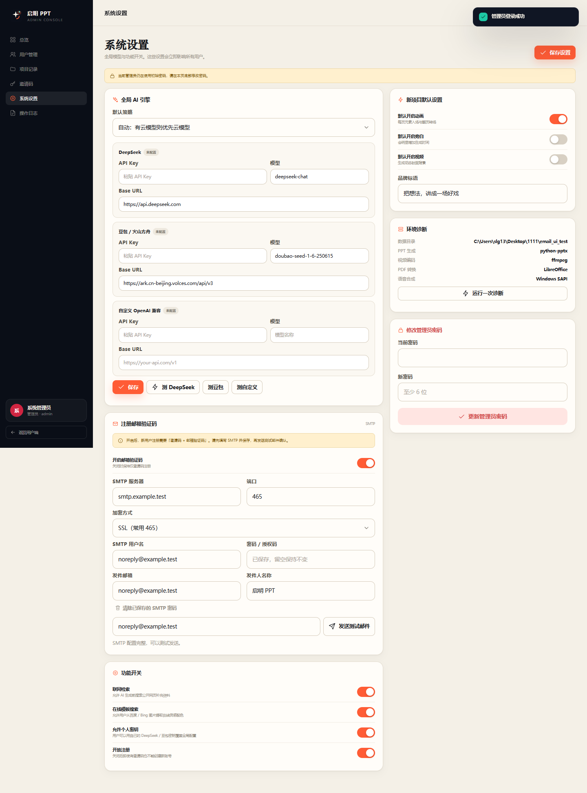

参考素材上传：

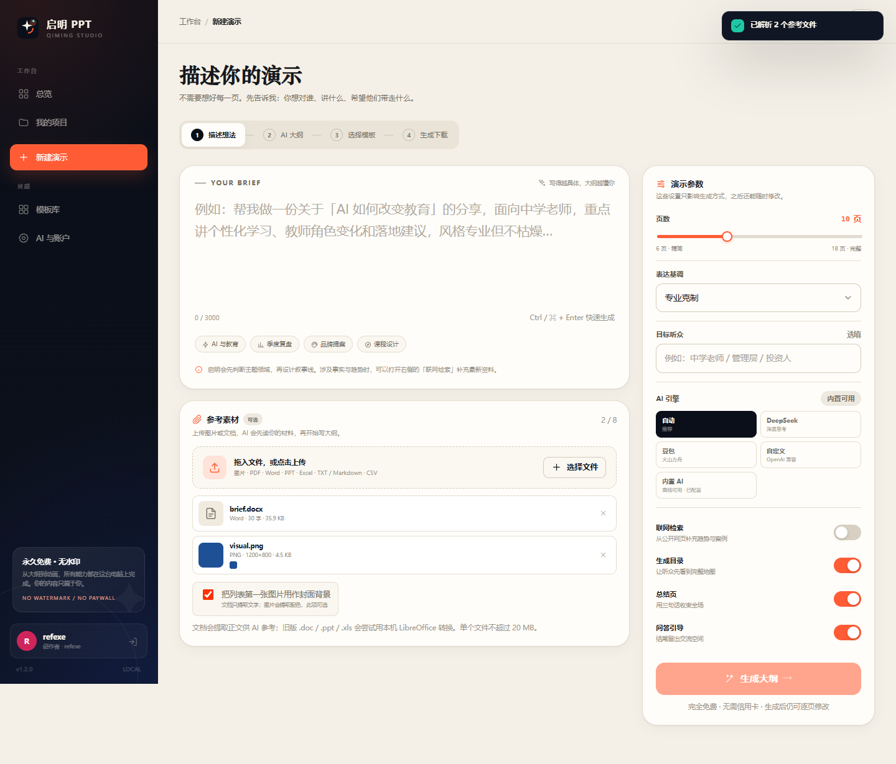

参考素材参与大纲：

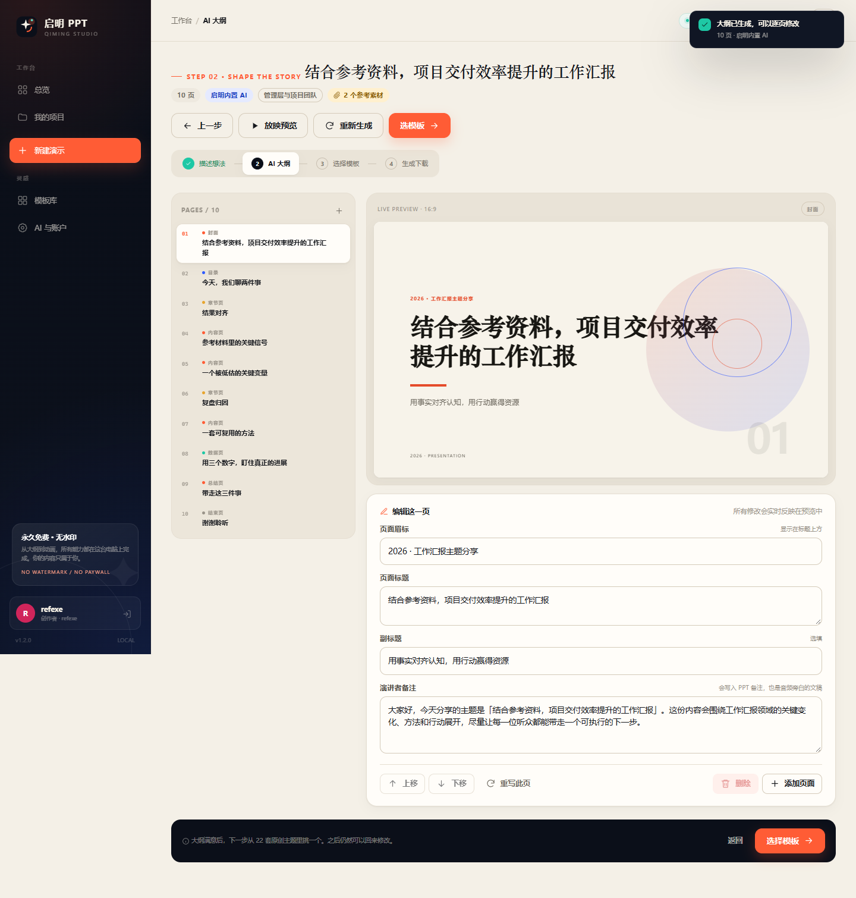

`docs/screenshots/` 中还包含账户设置与放映预览截图。

## 1. 这份软件能做什么

| 能力 | 说明 |
| --- | --- |
| AI 生成大纲 | 支持 6—50 页，可输出中文或英文课件；可选 DeepSeek、豆包、自定义接口或离线内置 AI |
| 联网检索 | 生成前可检索公开网页，把趋势与案例吸收进大纲，并在界面列出参考来源 |
| 参考素材 | 可上传文档和图片；文档提取正文，图片可提取配色/作封面，课文图片还会 OCR 成文字交给 AI |
| 大纲编辑 | 逐页修改标题、副标题、要点、数据、金句、演讲者备注；支持添加 / 删除 / 排序 / 单页重写 |
| 模板系统 | 22 套原创主题（商务、教育、科技、创意、中国风、简约、高级、自然） |
| 联网模板 | 从公开图片搜索中提取模板灵感与配色；可只使用配色，生成完全原创的封面 |
| 动画 | 每页元素自动依次入场；淡入 / 飞入 / 擦除 / 缩放；分页带转场；可调强度 |
| 旁白音频 | 11 种神经网络声音，可试听；含温柔女声、成人男声、中英文童声，中英文自动切换 |
| 动态视频 | 本机用 ffmpeg 生成抽象动态封面视频，嵌入 PPT 循环播放 |
| 课文朗读 | 从文档或课文图片自动识别（Windows OCR），生成朗读页；中文/英文课文都能读 |
| 自动放映 | 开启旁白后，按每页音频时长自动翻页 |
| 无水印导出 | PPTX 可直接在 PowerPoint 中编辑；PDF 通过 LibreOffice 导出 |
| 账号 | 注册 / 登录 / 退出；邀请码 + 可选邮箱验证码 |
| 管理后台 | 用户注册信息、项目、邀请码使用记录、全局 AI 密钥、SMTP 邮件、功能开关、操作日志、CSV 导出 |
| 桌面 exe | 单文件 Windows 程序，自动启动本地服务并打开 WebView2 窗口 |

**软件完全免费，没有付费墙，不添加任何水印或广告。**

仓库内附带一份 12 页示例：[`samples/启明PPT-示例-人工智能与教育.pptx`](samples/启明PPT-示例-人工智能与教育.pptx)，可直接用 PowerPoint 打开查看排版与动画窗格。

## 2. 立刻运行

### 2.1 直接使用 exe（推荐给最终用户）

在 `dist/` 中双击 **`启明PPT.exe`**。

- 系统：Windows 10 / 11（x64）。
- 需要系统自带 **Microsoft Edge WebView2 Runtime**（绝大多数 Windows 10/11 已有）。
- 首次启动会在 `%LOCALAPPDATA%\QimingPPT\` 创建数据库与目录。
- 如果窗口没有出现，请查看 `%LOCALAPPDATA%\QimingPPT\logs\launcher.log`，或运行 `启明PPT.exe --no-window` 用浏览器打开。

### 2.2 从源码运行

```powershell
# Python 3.11+，本项目在 Python 3.13 测试通过
python -m pip install -r requirements.txt
python app.py
```

开发时如果不想弹独立窗口：

```powershell
python app.py --no-window
# 或者只启动本地服务，手动打开 http://127.0.0.1:8765/
python app.py --server --port 8765
```

### 2.3 重新打包 exe

```powershell
python -m pip install -r requirements-build.txt
python build_exe.py
```

输出：

- `dist/QimingPPT.exe`（原始文件名）
- `dist/启明PPT.exe`（可直接交付）

## 3. 注册、登录与邀请码

- 注册页必须填写邀请码：**`songyonghao2016`**
- 邀请码区分大小写；修改代码中的 `MASTER_INVITE_CODE` 才能更换。
- 用户名 3—20 位，支持中文、字母、数字、下划线；密码至少 6 位。
- 注册成功会自动登录。
- 管理员可以关闭注册，但邀请码本身不会改变。
- 邮箱验证码默认关闭。管理员配置 SMTP 并开启后，注册流程变为：
  **邀请码 + 邮箱 + 6 位邮箱验证码**。
- 验证码 10 分钟有效、60 秒后可重发、最多尝试 5 次；同一个邮箱一小时最多发送 5 次。

### 3.1 邮箱验证码 / SMTP 配置

这是可选的，但推荐开启：

1. 准备一个支持 SMTP 的发件邮箱。**不要填登录密码，要填邮箱服务商提供的 SMTP 授权码。**
2. 打开「管理后台 → 系统设置 → 注册邮箱验证码」。
3. 填写 SMTP 服务器、端口、加密方式、用户名、授权码、发件邮箱、发件人名称。
4. 点击「保存设置」。
5. 在「测试收件邮箱」中填一个邮箱，点「发送测试邮件」。
6. 收到测试邮件后，再打开「开启邮箱验证码」开关并保存。
7. 回到用户端注册页刷新，就会出现「获取验证码」。

常见邮箱参数：

| 邮箱 | SMTP 服务器 | 端口 | 加密 |
| --- | --- | --- | --- |
| QQ 邮箱 | `smtp.qq.com` | 465 | SSL |
| 163 邮箱 | `smtp.163.com` | 465 | SSL |
| 126 邮箱 | `smtp.126.com` | 465 | SSL |
| 企业邮箱 | 由管理员提供 | 通常 465 / 587 | SSL / STARTTLS |

> QQ / 163 等邮箱需要在网页版设置中先开启 SMTP 服务并生成授权码。
> 如果发件服务器连接失败，请检查端口、SSL/STARTTLS 选项和授权码。
> 短信验证码需要阿里云/腾讯云等付费短信服务，不在本版本中。

## 4. 管理后台

- 地址：`http://127.0.0.1:<端口>/admin`，桌面版登录后可在左侧菜单或「AI 与账户 → 数据与关于」进入。
- 初始管理员账号：**`admin`**
- 初始管理员密码：**`Admin@2016`**
- 首次启动后，密码也会写入：
  `%LOCALAPPDATA%\QimingPPT\管理员初始账号.txt`
- **第一次登录后请立即在「系统设置 → 修改管理员密码」中改掉初始密码。**
  修改成功后，这个初始密码文件会自动删除。
- 后台功能：
  - 总览：用户、注册、项目、下载、7 天趋势、邀请码使用
  - 用户管理：注册信息、项目数、启用 / 停用、重置密码
  - 项目记录：所有用户项目、文件大小、下载次数、删除
  - 邀请码：唯一邀请码、完整使用记录、复制
  - 系统设置：全局 DeepSeek / 豆包 / 自定义密钥、SMTP 邮件验证码、联网开关、个人密钥开关、注册开关、默认动画 / 旁白 / 视频
  - 操作日志：登录、注册、生成、下载、后台动作
  - CSV 导出：用户、项目

## 5. AI 配置

软件**不配置任何密钥也能使用**，此时会走「启明内置 AI」：
领域识别 + 叙事规划 + 可选的联网检索 + 本地内容库，完全离线。

### 5.1 DeepSeek

1. 到 <https://platform.deepseek.com/> 创建 API Key。
2. 管理后台 → 系统设置 → 全局 AI 引擎 → DeepSeek，填入 Key。
3. 模型默认 `deepseek-chat`，Base URL 默认 `https://api.deepseek.com`。
4. 点「测 DeepSeek」验证，再保存。

### 5.2 豆包（火山方舟）

1. 在火山方舟控制台创建推理接入点（Endpoint）。
2. 后台填入 API Key、Endpoint ID（例如 `ep-xxxxxxxx`）和 Base URL
   `https://ark.cn-beijing.volces.com/api/v3`。
3. 模型一栏填 **Endpoint ID**，不是模型展示名。

### 5.3 自定义模型

任何兼容 `POST /chat/completions` 的服务都可以。后台填 Base URL、模型名、API Key。

> 用户也可以在工作台「AI 与账户 → AI 模型」用自己的密钥覆盖全局配置；
> 管理员可以在后台关闭这个能力。密钥只保存在本机 SQLite 数据库，不会上传到本软件作者。

### 5.4 内置 AI 的边界

内置 AI 是为「无密钥也能完整走通流程」设计的离线结构化引擎。它比云端大模型更稳定、
更可控，但创造力和领域深度有限。需要更高质量的文案时，接入 DeepSeek / 豆包即可。

### 5.5 长演示：最多 50 页

- 新建演示页可选择 **中文 / English** 输出语言。选择 English 后，封面、目录、内容页、备注、朗读页都会用英文生成；内置 AI 也有独立英文结构。

- 新建演示页的页数滑块为 **6—50 页**，并提供 10 / 20 / 30 / 50 页快捷按钮。
- 20 页以上会自动拆成更多章节：20—29 页至少 4 个章节，30—39 页至少 5 个，
  40 页以上建议 6 个章节。
- 云端模型会收到「长演示结构」提示，并放宽输出 token 上限；生成可能需要 1—2 分钟。
- 内置 AI 会为 6 个章节分别生成不同标题与要点，目录页会自动排成 6 项。
- 如果云端模型返回的页数不足，软件会补齐延伸页；如果返回过多，会按顺序精简到目标页数。
- 单份演示最多 50 页；大纲编辑页也不能再手工添加超过 50 页。

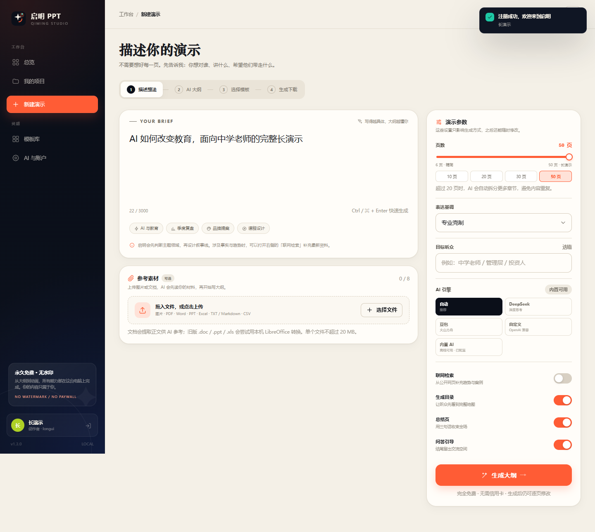

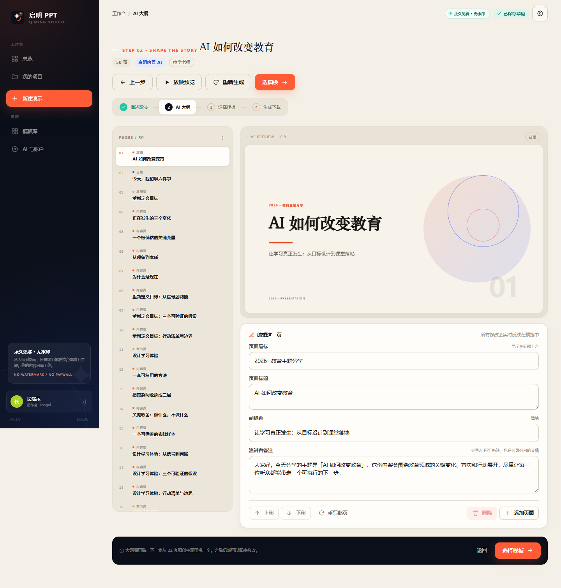

## 6. 参考素材：文档与图片

创建页下方有「参考素材」区域，可以拖入或选择多个文件。它们会随草稿保留，并参与 AI 大纲与最终 PPT。

### 6.1 支持格式

| 类型 | 格式 | 处理方式 |
| --- | --- | --- |
| PDF | `.pdf` | 提取文字；扫描版 PDF 需要 OCR，本版本不包含 |
| Word | `.docx` | 提取段落与表格 |
| Word 旧版 | `.doc` / `.rtf` / `.odt` | 通过本机 LibreOffice 转 PDF 后提取 |
| PowerPoint | `.pptx` | 提取每页文字与备注 |
| PowerPoint 旧版 | `.ppt` / `.odp` | 通过本机 LibreOffice 转 PDF 后提取 |
| Excel | `.xlsx` / `.xlsm` | 读取工作表单元格 |
| Excel 旧版 | `.xls` / `.ods` | 通过本机 LibreOffice 转 PDF 后提取 |
| 文本 | `.txt` / `.md` / `.csv` / `.tsv` / `.json` / `.html` / `.xml` | 直接读取或抽取正文 |
| 图片 | `.png` / `.jpg` / `.jpeg` / `.webp` / `.gif` / `.bmp` / `.tif` / `.tiff` | 提取主色、可作封面；课文朗读时可用 Windows OCR 识别文字 |

- 一次最多 8 个文件，单个不超过 20 MB。
- 文档正文会截取前 18,000 字进入 AI 上下文；超长内容会在界面提示。
- 旧版 Office 格式需要本机安装 LibreOffice；没有安装时会提示无法解析，不影响其他格式。
- 扫描版 PDF 暂不自动 OCR；但如果把课文拍照/截图作为图片上传，课文朗读会调用 Windows OCR 识别图片文字。

### 6.2 文档如何参与生成

1. 在「新建演示」页上传文档。
2. 正常填写主题并生成大纲。
3. 文档正文会作为「参考材料」加入云端 AI 的提示词；内置 AI 会提取其中句子，生成一页「参考材料里的关键信号」。
4. 生成 PPT 时，参考素材不会被写成广告或水印，只是内容与视觉依据。

> 不要把参考文档当作指令。即使文档里写了「忽略之前的要求」，软件也只把它当素材。

### 6.3 图片如何参与生成

- 自动提取 5 个主色，在文件卡片上显示色块。
- 勾选「把列表第一张图片用作封面背景」后，生成时会用这张图做封面视觉；
  不勾选时，图片不会进入 PPT，只显示提取的配色供你参考。
- 图片用于封面/配色时不会自动识别内容；但「课文朗读 → 从参考文档识别」会对课文图片做 OCR，识别出的文字可编辑。
- 用作封面的原图会嵌入 PPTX，不会加水印。

## 7. 动画、音频、视频说明

### 动画

- 开关：「生成演示 → 元素动画」。
- 动画应用到**每一页**：标题、卡片、数据、图片依次出现，分页使用淡入 / 推入 / 擦除 / 覆盖转场。
- 动画由 PowerPoint 原生时间轴（OOXML `p:timing`）驱动，不是视频伪装的动画；可在 PowerPoint
  的「动画窗格」中看到并继续编辑。
- 关闭动画后，生成的 PPTX 不包含对象动画和翻页转场（若同时需要旁白自动翻页，会保留仅用于计时的
  空转场载体）。

### 旁白

- 开关：「逐页旁白」。
- 在「生成演示」页可以选择中文声音和英文声音，并点击「试听」。
- 中文声音：晓晓（温柔女声）、晓伊（活泼女声）、云夏（可爱童声）、云希（阳光男声）、云扬（沉稳男声）。
- 英文声音：Ana（英文童声）、Jenny / Ava（英文女声）、Andrew（英文男声）、Sonia / Ryan（英音）。
- 优先使用 Microsoft Edge 神经网络语音；网络不可用时自动回退到本机 Windows SAPI，不会中断生成。
- 英文课文会自动切换到你选择的英文声音；中文课文使用中文声音。
- 开启后可按每页旁白时长自动翻页；也可以保留手动点击。

### 课文朗读

1. 在「新建演示」页上传含课文的 Word / PDF / TXT，或上传课文照片/截图，也可以直接粘贴课文。
2. 点击「从参考文档识别」；教学类提示词下上传文档或图片后也会自动尝试识别。图片调用 Windows 内置 OCR。
3. 生成大纲时会自动插入一页「课文朗读」，正文同时成为朗读音频文稿。
4. 英文课文会自动使用英文声音；中文课文用中文声音。
5. 生成后在放映模式下进入朗读页会自动播放。

### 动态视频

- 开关：「动态封面视频」。
- 使用内置 ffmpeg 和 Pillow/NumPy 渲染一段 4.5 秒抽象动态背景，嵌入封面并循环播放。
- 视频是本地生成的抽象视觉，不依赖外部视频站点，也不使用版权素材。
- 若 ffmpeg 组件异常，软件会跳过视频并继续导出。

### 放映预览

项目详情或生成完成页可以点「放映预览」：16:9 全屏预览、自动翻页、左右键切换。
开启旁白时，预览会尝试用浏览器/WebView2 的 `speechSynthesis` 朗读当前页备注（不需要联网）。

## 8. 模板与联网搜索

- 内置 22 套主题，每套包含封面、目录、章节、内容、数据、金句、总结、结束页的专门版式。
- 「联网灵感」会搜索公开图片，提取主色并生成一套可编辑主题。
- 因为搜索结果可能是竖版课件预览图，默认只提取配色（不直接使用图片背景）；你可以在模板详情里
  勾选「使用这张图片作为封面背景」。
- 在线图片可能涉及第三方版权，商用前请自行确认授权。软件不会给导出文件添加水印。

## 9. 数据与隐私

| 内容 | 位置 |
| --- | --- |
| 数据库 | `%LOCALAPPDATA%\QimingPPT\qiming.db` |
| 项目文件 | `%LOCALAPPDATA%\QimingPPT\projects\<id>\` |
| 语音缓存 | `%LOCALAPPDATA%\QimingPPT\cache\voice\` |
| 参考素材 | `%LOCALAPPDATA%\QimingPPT\references\<用户 id>\` |
| 在线缩略图 | `%LOCALAPPDATA%\QimingPPT\cache\online\` |
| 日志 | `%LOCALAPPDATA%\QimingPPT\logs\` |
| 管理员初始密码 | `%LOCALAPPDATA%\QimingPPT\管理员初始账号.txt` |

- 软件默认只监听 `127.0.0.1`，不对外网开放。
- 密码使用 PBKDF2-SHA256（310,000 次迭代）哈希保存，后台也看不到明文。
- API Key 明文保存在本机数据库（仅本机可读），不会发给作者服务器。
- 没有统计、遥测、广告 SDK；唯一的出站请求发生在你启用联网检索、联网模板，或调用你配置的
  云模型时。
- 上传的参考文档默认只保存在本机。只有在生成大纲且使用云端 AI 时，提取出的正文才会发送给
  你配置的模型接口；图片不会上传到任何识别服务。
- 生成的内容会留在本机；删除项目会删除对应文件夹。删除参考素材会删除原文件和提取文本。

## 10. 目录结构

```
1111/
├─ app.py                     桌面启动器：Flask + Waitress + pywebview
├─ backend/
│  ├─ __init__.py             Flask app 工厂 / 安全响应头
│  ├─ api.py                  用户、模板、项目、管理员 JSON API
│  ├─ auth.py                 注册、登录、会话、资料、密码
│  ├─ ai.py                   云端模型 + 内置 AI 大纲引擎
│  ├─ animations.py           PowerPoint 原生动画 / 转场 XML
│  ├─ config.py               路径、常量、默认设置
│  ├─ db.py                   SQLite 数据层
│  ├─ jobs.py                 后台生成任务与进度
│  ├─ media.py                TTS、抽象背景、动态视频、PDF
│  ├─ mailer.py               SMTP 邮件与注册验证码发送
│  ├─ pptx_builder.py         16:9 演示排版与导出
│  ├─ references.py           图片 / PDF / Office / 文本参考素材解析
│  ├─ research.py             百度 / Bing 联网检索与在线模板
│  ├─ security.py             密码哈希、会话令牌、登录限流
│  ├─ themes.py               22 套主题
│  └─ utils.py                通用工具
├─ frontend/
│  ├─ index.html              用户端
│  ├─ admin.html              管理后台
│  └─ assets/                 CSS / JS / 图标
├─ docs/screenshots/          界面截图
├─ samples/                   示例 PPTX
├─ tests/                     核心流程测试
├─ qiming.spec                PyInstaller 打包配置
├─ build_exe.py               打包脚本
├─ requirements.txt
└─ README.md
```

## 11. 测试

```powershell
python -m unittest discover -s tests -v
```

当前 12 项测试覆盖：邀请码注册、邮箱验证码、最长 50 页大纲、参考文档解析、项目生成、
无动画导出、50 页动画 / 转场、音视频自动播放、权限、资料修改、管理员密码文件清理。

测试覆盖：邀请码注册（错误 / 正确）、登录、大纲生成、项目创建、生成 PPTX、
下载、管理员权限与统计。生成测试会写入临时数据目录，不污染正式数据（见测试文件配置）。

## 12. 常见问题

**窗口打不开 / 白屏**  
安装 Microsoft Edge WebView2 Runtime；或运行 `启明PPT.exe --no-window` 用默认浏览器打开。
查看 `%LOCALAPPDATA%\QimingPPT\logs\launcher.log`。

**生成很慢**  
纯 PPT 通常十几秒；开启旁白需要逐页调用 Windows 语音合成，开启视频需要编码，可能 30—90 秒。
生成在后台进行，可返回总览，完成后项目会变为「已完成」。

**PDF 下载提示不可用**  
PDF 转换依赖本机安装的 LibreOffice。直接下载 PPTX 即可；或在装有 Office 的电脑上另存为 PDF。

**旁白没有声音 / 被跳过**  
Windows 需要至少一个中文语音。打开「设置 → 时间和语言 → 语音」安装中文语音包，
或在 PowerShell 中检查：
```powershell
Add-Type -AssemblyName System.Speech
(New-Object System.Speech.Synthesis.SpeechSynthesizer).GetInstalledVoices() | ForEach-Object { $_.VoiceInfo.Name }
```

**播放在其他电脑上没有字体**  
PPT 使用微软雅黑；如果对方电脑缺少字体，请在 PowerPoint 中「替换字体」或嵌入字体。
软件不随包分发商业字体。

**杀毒软件误报**  
PyInstaller 单文件程序常见误报。可把 `dist/启明PPT.exe` 加入信任，或从源码运行。

**端口被占用**  
桌面版会自动从 8765 开始寻找空闲端口；如果多个实例，单实例机制会复用已有窗口。

## 13. 许可

本软件源代码使用 MIT License，详见 `LICENSE`。第三方组件与动画 XML 来源详见
`THIRD_PARTY_NOTICES.md`。

导出文件不添加水印；但联网图片、模板灵感与外部模型的版权/服务条款由使用者自行确认。
